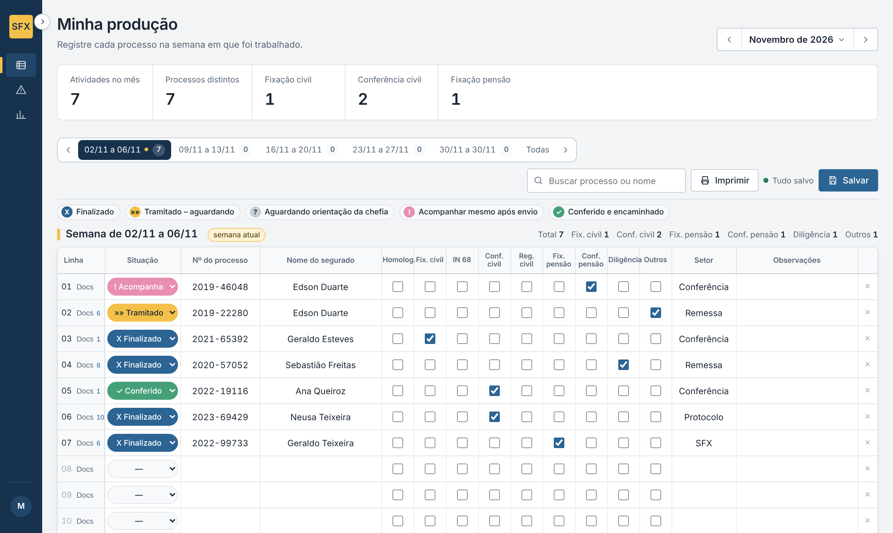
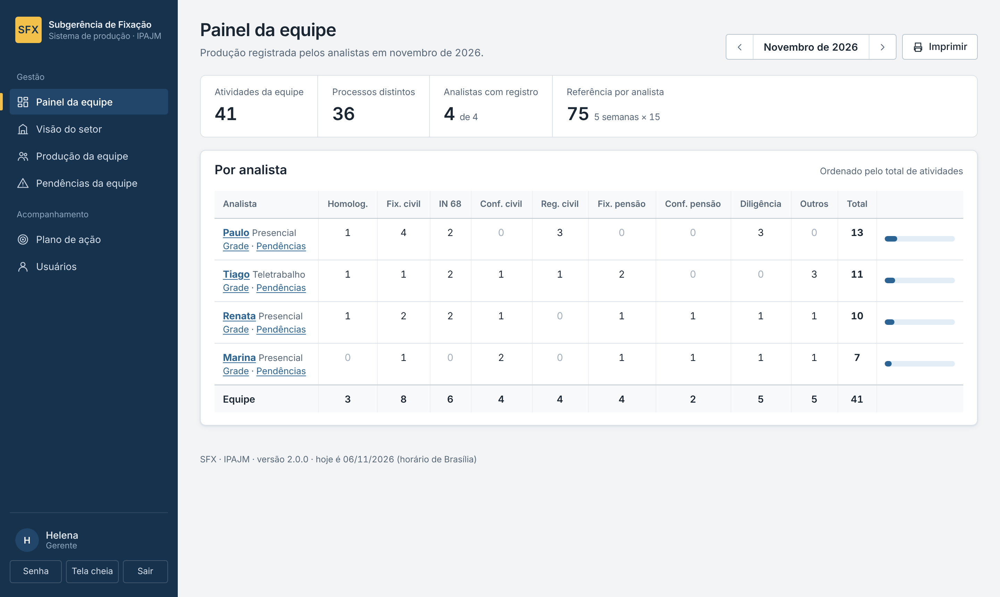
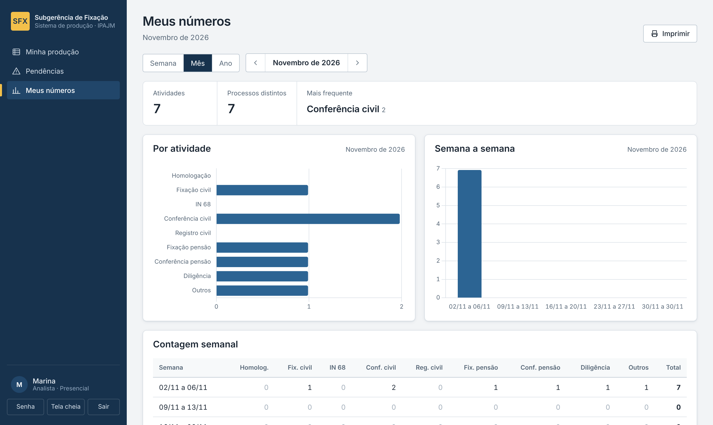
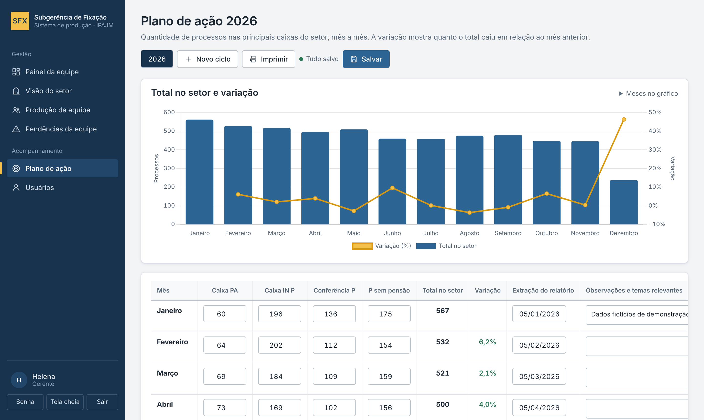
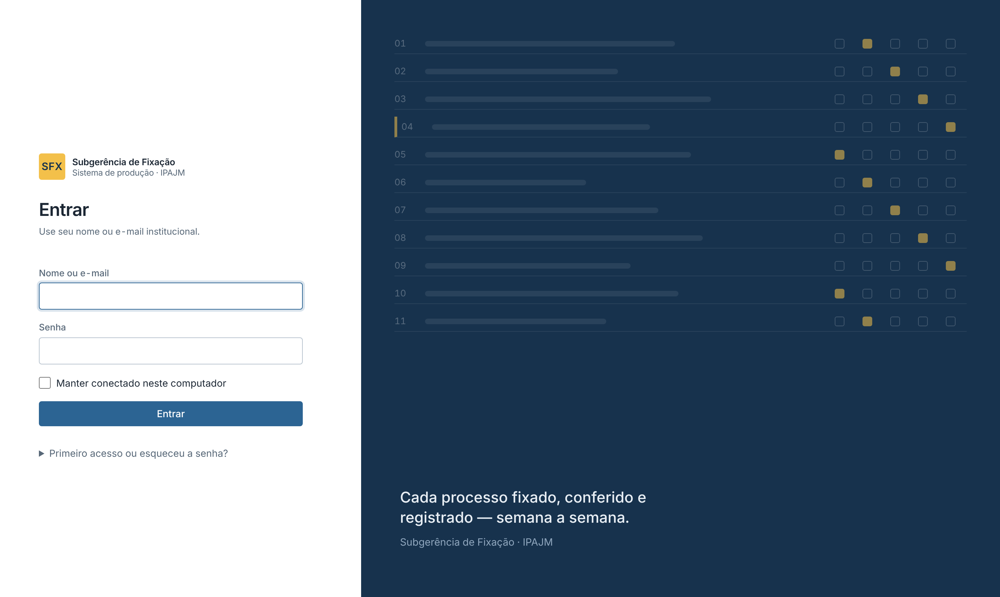

# SFX · Sistema de Produção

Sistema web da **Subgerência de Fixação (SFX)** para registrar, acompanhar e analisar a produção semanal dos analistas: processos fixados, conferidos, homologados e em diligência, conferência documental, pendências e o plano de ação do setor.



> As imagens deste README usam **dados fictícios** gerados por `flask demo popular`.

## O que o sistema faz

| Perfil | Pode |
| --- | --- |
| **Analista** | Lançar a produção da semana numa grade única (situação, nº do processo, segurado, 9 atividades, setor, observações e checklist de 18 documentos); acompanhar pendências e registrar como foram resolvidas; ver os próprios números por semana, mês ou ano. |
| **Estagiária** | Lançar e corrigir a produção de qualquer analista; consultar pendências da equipe. |
| **Subgerente, gerente, diretora** | Tudo o que a estagiária faz, mais o painel da equipe, a visão anual do setor, os números de cada analista, o plano de ação e o cadastro de usuários. |
| **Administrador** | Igual à gestão, e também cria outros administradores. |

Destaques:

- **Grade de produção** com semanas úteis do mês, semana atual marcada, contagens que se atualizam enquanto você digita, linhas que entram e saem sem recarregar, aviso de alterações não salvas, `Ctrl+S` para salvar e impressão por semana.
- **Busca** por nº do processo ou nome do segurado em todos os meses, com link direto para a linha.
- **Pendências**: tudo que está *tramitado*, *aguardando orientação* ou *a acompanhar* aparece automaticamente; dá para arquivar, reabrir e registrar a resolução.
- **Painel da equipe** e **visão do setor** com gráficos (Chart.js servido localmente — funciona sem internet na intranet).
- **Plano de ação** (antiga planilha `Pasta2.xlsx`) agora no banco: totais e variação calculados ao vivo, ciclos anuais e importação da planilha antiga.
- **Gestão de usuários** com senha provisória gerada pelo sistema, troca obrigatória no primeiro acesso e desativação sem perder histórico.

| | |
| --- | --- |
|  |  |
|  |  |

## Colocar no ar em 5 minutos (Windows, rede interna)

1. Instale o [Python 3.11+](https://www.python.org/downloads/) marcando **Add python.exe to PATH**.
2. Baixe este repositório (botão **Code → Download ZIP**) e extraia numa pasta fixa, ex.: `C:\SFX`.
3. Se já usa a versão 1, copie a pasta `instance\` (banco) e `data\Pasta2.xlsx` para dentro dela.
4. Clique duas vezes em **`INICIAR_SFX.bat`**.

Na primeira vez ele cria o ambiente, gera a chave secreta, faz backup e atualiza o banco, importa o plano de ação e mostra o endereço para os colegas (ex.: `http://10.0.0.25:8000`). Nas próximas, só inicia. Deixe a janela aberta enquanto o sistema estiver em uso.

## Começando (desenvolvimento)

Requer **Python 3.11+**.

```bash
git clone https://github.com/albertjr99/SFX.git
cd SFX
python -m venv .venv
source .venv/bin/activate            # Windows: .venv\Scripts\Activate.ps1
pip install -r requirements-dev.txt
cp .env.example .env                 # Windows: copy .env.example .env

flask --app wsgi db upgrade          # cria/atualiza o banco em instance/producao.db
flask --app wsgi demo popular        # opcional: usuários e produção fictícios
flask --app wsgi run --debug
```

Abra <http://localhost:5000> e entre com `Marina` / `demo1234` (analista) ou `Helena` / `demo1234` (gerente).

## Comandos úteis

```bash
flask --app wsgi usuarios listar
flask --app wsgi usuarios criar --nome Ana --email ana@orgao.gov.br --tipo analista --modalidade presencial
flask --app wsgi usuarios redefinir-senha Ana        # gera nova senha provisória
flask --app wsgi plano importar caminho/Pasta2.xlsx  # importa a planilha antiga do plano de ação
flask --app wsgi db upgrade                          # aplica migrações pendentes
pytest                                               # testes
ruff check . && ruff format --check .                # lint
```

## Produção

1. Defina `SFX_ENV=production` e uma `SECRET_KEY` forte no `.env` (o sistema se recusa a subir sem ela).
2. Rode `flask --app wsgi db upgrade`.
3. Suba o servidor:
   - **Linux**: `gunicorn wsgi:app --workers 2 --threads 4 --bind 0.0.0.0:8000`
   - **Windows**: `waitress-serve --listen=0.0.0.0:8000 wsgi:app`
   - **Docker**: `docker compose up -d --build` (aplica as migrações sozinho; o banco fica no volume `sfx-dados`).
4. Sirva atrás de HTTPS. Se for usar HTTP puro na intranet, defina `SESSION_COOKIE_SECURE=false`; atrás de proxy reverso, `PROXY_FIX=true`.

`GET /healthz` responde `{"status": "ok"}` para monitoramento.

Todas as variáveis estão documentadas em [`.env.example`](.env.example).

## Atualizando da versão 1

Veja **[docs/MIGRACAO.md](docs/MIGRACAO.md)** — o banco atual é aproveitado integralmente.

## Estrutura

```
sfx/
  __init__.py          create_app(): configuração, extensões, segurança, erros
  config.py            configuração por variáveis de ambiente
  constants.py         atividades, documentos, situações, perfis, meses
  models.py            Usuario, LinhaProducao, PlanoAcaoCiclo, PlanoAcaoMes
  security.py          controle de acesso, política de senha, limite de tentativas
  cli.py               comandos flask (usuarios, plano, demo)
  services/            regras de negócio (períodos, grade/estatísticas, plano de ação)
  blueprints/          rotas: auth, producao, gestao, plano, admin, legado
  templates/  static/  interface (CSS e JS próprios, fonte Inter e Chart.js locais)
migrations/            Alembic (inclui as migrações da v1)
tests/                 pytest
```

## Segurança e LGPD

O sistema guarda nomes de segurados e números de processo. Por isso:

- banco, planilhas e uploads **nunca** vão para o Git (`.gitignore`);
- páginas são servidas com `Cache-Control: no-store`, CSP restritiva, proteção CSRF em todos os formulários e cookies `HttpOnly`/`SameSite`;
- senhas com hash (Werkzeug), política mínima, troca obrigatória da senha provisória e bloqueio temporário após tentativas seguidas;
- cada linha registra quem a alterou por último e quando.

Datas e horas aparecem sempre no horário de Brasília (`America/Sao_Paulo`) e no formato dd/mm/aaaa, mesmo que o servidor esteja em outro fuso; no banco os instantes ficam em UTC.

Faça backup periódico de `instance/producao.db` (ou do banco configurado).
